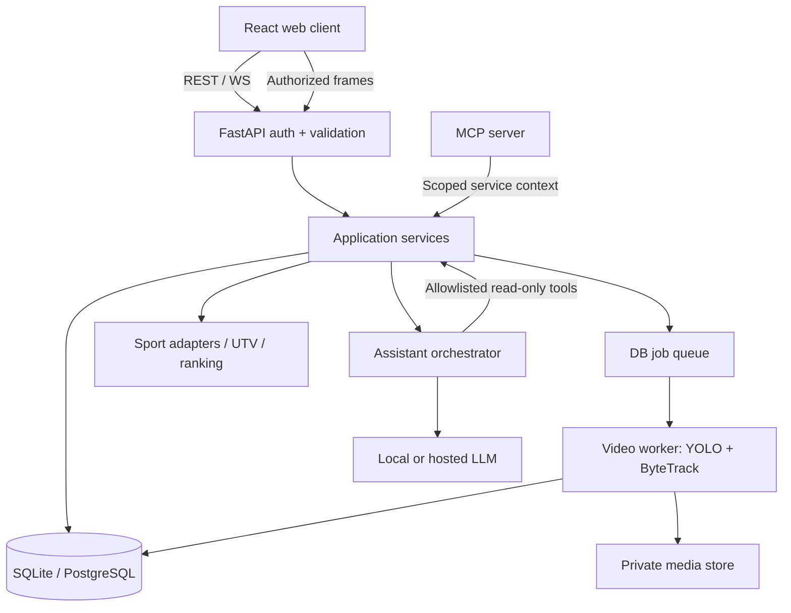

# VIXISU | 02 — Technical Requirements Document

Version 1.0 • 24 November 2026 • Proposed implementation baseline • Read after 01_PRD.md

## 1. Existing code audit and migration policy

Inspected the supplied ATHLON ZIP, README, project status and Python modules. It contains FastAPI, SQLite, a no-build JS/CSS SPA, 16 fictional seed profiles, normalized/raw CSV import, deterministic role/skill/gap scoring and synchronous OpenCV HOG/optional YOLO person detection. The previous project status reports 14 passing tests; this documentation task did not rerun them. No authentication, real dataset adapters, tracking, validated movement metrics, live sessions, MCP or LLM assistant are implemented in that baseline. Do not describe these planned upgrades as shipped. Preserve `app/data.py`, `app/ingestion.py`, `app/intelligence.py` and tests as regression references; migrate incrementally. Legacy per-frame PERSON labels are not track IDs. Existing `/outputs` access and unauthenticated endpoints must be removed or protected before hosting.

## 2. Locked stack and cost policy

| Layer | Choice | Notes |
|---|---|---|
| Frontend | React + TypeScript + Vite | React Router, TanStack Query, Zod, Tailwind CSS, Lucide, Recharts |
| Motion/3D | CSS, GSAP core or Motion, Three.js via React Three Fiber | Choose one animation library; check terms, lazy-load 3D; static fallback |
| Backend | Python 3.11, FastAPI, Pydantic, Uvicorn | Versioned JSON REST and WebSockets |
| Persistence | SQLAlchemy 2 + Alembic; SQLite local, PostgreSQL hosted | Portable types; enable SQLite foreign keys; PostgreSQL production tests |
| Auth | Argon2id password hashing, server-side opaque sessions | HttpOnly same-site cookies, CSRF checks, no paid auth dependency |
| Jobs | DB-backed queue + single worker process | Atomic claim, leases, retry, cancellation; no Redis required |
| CV | OpenCV, PyTorch, YOLO small/nano checkpoint, ByteTrack | Configurable model/device; confirm package and weight licenses; no forced downloads |
| Data/ML | Pandas, NumPy, scikit-learn as needed | Domain adapters and deterministic ranker; no unnecessary training |
| Assistant | Provider interface: Ollama local; configurable hosted compatible API | Hosted opt-in only; no assumed free quota; template fallback |
| MCP | Official Python MCP SDK, stdio local | Streamable HTTP only if auth/TLS implemented; same service permissions as REST |
| Tests | pytest, HTTPX, Vitest, React Testing Library, Playwright | CPU fixtures; optional real model test marker |
| Delivery | Git, GitHub if available, Docker Compose, Windows script | Pin verified dependency versions in lockfiles; do not assume GPU |

Zero mandatory cost: no billing-required API, managed DB or cloud GPU. Review license obligations for code, weights, datasets, fonts and assets. Ultralytics packages/models may carry AGPL or other terms; verify the selected release/weights and document obligations. If incompatible, choose an appropriately licensed YOLO implementation/checkpoint with a tracker adapter, not a silent license violation. Hosted providers may change free quotas; select only after checking current terms, resource limits and no required spend. Local operation is authoritative.

## 3. Architecture and interfaces



Serve built frontend and API from one origin by default. Development Vite proxy `/api` and `/ws` to FastAPI; production same-origin cookies. Use `/api/v1` and `/ws/v1`; legacy API compatibility only for safe local migration, never bypass auth. REST OpenAPI schema is the contract; generate frontend types or maintain tested typed client. No direct browser DB access or provider secrets. Domain adapters implement `validate_raw`, `aggregate`, `derive_metrics`, `feature_catalog`, `role_templates`; `SportAdapter` registry keyed by sport. Add esports later via adapter, no schema rewrite. Keep video processing separate from statistical scoring.

## 4. Repository target

```text
VIXISU/
  AGENTS.md
  README.md
  .env.example
  docs/01_PRD.md ... 06_IMPLEMENTATION_PLAN.md
  docs/PROGRESS_TRACKER.md
  app/                         # retain FastAPI package
    main.py
    api/v1/                    # routers
    core/                      # settings, auth, policy, errors
    db/                        # models, sessions, repositories
    domains/{cricket,football}/
    intelligence/              # normalization, UTV, ranking, explanations
    services/                  # import, teams, reports, assistant
    vision/                    # detector, tracker, calibration, jobs, live
    mcp_server.py
    worker.py
  migrations/
  frontend/src/{pages,components,features,lib,styles}/
  web/                         # legacy until parity verified
  scripts/                     # dataset fetch, migration, seed, demo
  sample_data/                 # fictional fixtures + source manifests
  tests/{unit,integration,e2e,fixtures}/
  compose.yaml
```

Python snake_case; TS PascalCase components/camelCase values; UTC ISO-8601 timestamps; UUID strings; decimal units explicit; no secrets, model weights, private clips or raw dataset dumps in Git. Preserve original ZIP and make a baseline branch.

## 5. Dataset and ingestion contracts

| Source | Purpose | Plan |
|---|---|---|
| https://cricsheet.org/downloads/ | Cricket ball-by-ball | Choose one T20 competition/season, parse JSON; record source IDs and download date |
| https://github.com/statsbomb/open-data | Football events and lineups | Select one available competition/season; aggregate events with documented definitions; verify repository location/terms |
| https://www.soccer-net.org/data | Optional tracking evaluation | Use only permitted subset if access approved; otherwise controlled consented clips |
| User CSV | Normalized or raw aggregate data | Preview, validate, commit; distinguish user-reported vs dataset-derived |
| Consented videos | Recorded/live analysis | Short controlled clips, no redistribution without rights |

Source links are starting points, not a claim that access or licenses were verified today. Record dataset name, source URL, version/commit, checksum, license/terms, attribution, date, competition, season, sample window, transformations. Do not mix competitions or formats silently. Deduplicate by source ID and match/event key; don't merge players on name alone. CSV max 2 MiB/300 rows initially; UTF-8, schema version, finite nonnegative counts, integer counts where applicable, completed <= attempted; invalid rows previewed and rejected atomically by default. Keep zero distinct from null. Escape spreadsheet formula-leading text on export. Import batch checksum/idempotency prevents duplicates.

### Metric definitions (first supported feature catalog)

Cricket: batting average = runs/dismissals; strike rate = 100*runs/balls faced; boundary run share = (4*fours+6*sixes)/runs; bowling economy = 6*bowler-attributed runs conceded/legal balls bowled; bowling average = runs conceded/bowler-credited wickets; wickets per match; catches per match. Consistency only from >=5 comparable innings: use 1/(1+CV) where mean >0, with sample count. Count legal balls and extras using source definitions; do not treat 4.2 overs as decimal 4.2. Exclude run-outs from bowler wickets. Role templates: opener, middle-order, finisher, all-rounder, pace, spin, wicketkeeper; roles are supplied or source-verified, not inferred from appearance.

Football: pass completion = completed/attempted*100; goals/90 = 90*goals/minutes; assists/90 where source supports; shots on target/shots*100; successful dribbles/90; tackles+interceptions/90 (only if both known). Minutes from lineups/substitutions or validated source. No pace, vision, positioning or decision-making from aggregate counts alone. Roles: goalkeeper, defender, midfielder, forward; detailed roles only when verified. MVP eligibility minimum proposed: 5 cricket matches or 270 football minutes for dataset-based ranking; lower exposure marked provisional, excluded by default. Missing denominator or zero denominator => null, not zero. Preserve raw metric IDs, units, sample count and provenance. For imported normalized values, require scale and label user-reported/demo; never pass off as calibrated.

## 6. Universal Talent Vector and ranking specification

UTV is a common envelope, not a universal cross-sport skill scale. Example (fictional):

```json
{"sport":"cricket","role":"opener","cohort":"T20-demo-v1","version":"utv-1","features":{"strike_rate":{"raw":145,"unit":"runs_per_100_balls","score":75,"source_id":"fixture-01","n":200},"consistency":{"raw":null,"score":null,"reason":"insufficient_innings"}},"evidence_type":"fictional","reference_version":"ref-demo-1"}
```

Normalize within comparable sport/format/competition/role reference groups. Use frozen reference bounds (e.g. 5th/95th percentile with >=20 valid reference players; otherwise explicitly labeled demo bounds), clip to [0,100], reverse lower-is-better metrics. Formula `s=100*clip((x-lo)/(hi-lo),0,1)`; `100-s` for reversed. If hi<=lo or no reliable reference, null. Version bounds and algorithm; don't refit on every search. Only compare identical feature definitions/reference version; otherwise re-score to a common reference or warn and block direct score comparison.

Ranking v1 (retain legacy structure with explicit compatible-role mapping): validate nonnegative weights, normalize sum to 1; same sport, eligible role, permission, cohort and exposure. Exact role=100; explicit compatible role=70; incompatible excluded. Coverage C=sum weights with known compatible score; require C>=0.50; expose missing features and C. SkillFit=sum(w*s for available)/C. For existing roster, calculate mean normalized skill per available comparable feature; gap contribution = max(0,candidate score-roster mean) on weighted known features; GapBonus=min(8,0.08*weighted mean positive difference); no roster or comparable evidence => 0. FinalFit=min(100,0.85*SkillFit+0.15*RoleMatch+GapBonus). Sort by unrounded fit desc, coverage desc, UUID asc; display one decimal. Exclude existing roster members. Store immutable input/algorithm/reference versions and component explanations. Never claim score is probability of success. For no candidates, return exclusions by category and suggest reviewing requirements. Cosine similarity optional for same compatible feature space only, with missingness/zero norm guards.

Fixture: weights 0.6/0.4, scores 80/60, exact role, no roster => SkillFit=72, FinalFit=76.2, coverage 100%. Missing second feature => SkillFit=80, coverage 60%, FinalFit=83.0; show limited evidence. Missing first => coverage 40%, excluded. Test reverse normalization, clipping, all-zero weights, incompatible roles and deterministic ties.

## 7. Vision, tracking and movement validation

Recorded flow: validate file type/size and decode, create job, worker claims job, sample timestamped frames, YOLO person detection, ByteTrack per session, store boxes/confidence/track IDs and timestamps, render preview and output, persist summary. Initial limits: 25 MiB, 15 s analysis window, 720p max processing width, target 5 sampled FPS on CPU; expose actual sampling rate and truncation. Preserve timestamps and encode playable output with correct timing. Check writer success. Default confidence 0.30, tune on held-out clips; report model/checkpoint hash and config. Tracking IDs are temporary, not identity; no face matching. Separate player/person label; no unsupported ball/action/skill claims. If model absent, fail with setup guidance; optional HOG mode labeled detection-only and not accepted as YOLO milestone.

Live flow: browser `getUserMedia` (localhost/HTTPS) or authorized browser-playable stream/file source; user explicitly starts; send bounded JPEG frames with sequence and monotonic timestamp over authenticated WS. No arbitrary backend URL fetching (SSRF). Stream CORS/DRM may prevent capture; use an owned local HTTP stream for testing, never bypass protections. Session cap 60 s, max 5 frames/s, 200 KiB/frame, one active session/user, queue latest frame only, reject stale/oversized frames; close releases camera and tracker. Return boxes, temporary IDs, processing FPS, dropped frames and latency. No recording by default. GPU optional; if CPU inadequate reduce resolution/FPS or disable live with honest status.

Movement: track bottom-center point in pixels; duration = last-first timestamp; image-plane path length=sum Euclidean step distances in px, rate px/s. Exclude discontinuities, long gaps (>0.5 s), low-confidence points and identity switches; report usable fraction and sample count. Do not call px/s physical speed. For fixed-camera ground-plane only, use >=4 non-collinear known ground points with meter coordinates and additional held-out checkpoints; homography via OpenCV. Validate held-out position RMSE <=0.5 m and controlled measured path relative error <=10% (proposed thresholds, report actual); invalidate on camera pan/zoom/cut, poor tracking or insufficient checkpoints. Only then show estimated m and m/s with calibration ID, uncertainty and limitations. No video-derived UTV skill scores in MVP. Manually annotate held-out clips for detection precision/recall (IoU>=0.5), track ID switches, optionally IDF1 with ground truth. Separate calibration validation from detection evaluation.

## 8. Assistant, API and MCP

Assistant service calls allowlisted tools (05) with server-derived user context; model cannot set permissions. Retrieval returns minimal structured data with evidence IDs, source type and versions. Treat CSV text, media metadata, external content and model output as untrusted. No arbitrary SQL, filesystem, network or shell tools. Max 4 tool calls/request, 20 s provider timeout, bounded prompt/response, per-user rate limits. Render citations as internal authorized record links; reject unsupported numeric claims or return deterministic tool result. Assistant cannot modify ranks, publish profiles or contact players. Hosted opt-in: send only minimal nonpersonal/consented data, no clips or private identifiers; default local or template. Provider adapter `generate(messages, tools, timeout)`; `none` mode works offline. MCP local stdio uses scoped token from environment, read-only, never admin by default; HTTP optional only with verified auth and TLS. MCP is a protocol for tools/context, not a substitute for REST or an LLM. No paid provider required.

## 9. Environment and performance

See root `.env.example`. Validate config at startup, no secret values in client bundles, no automatic external downloads. Local Windows Python venv and Node LTS; Docker Compose API + worker + optional PostgreSQL. Health/readiness reports DB, worker and model availability without exposing paths/secrets. Benchmark hardware in Week 1 (RAM, CPU, GPU/VRAM, inference time); record actual results. CPU-first; one worker, model cached per worker, bounded memory and storage, no concurrent GPU training. Static asset compression, lazy 3D, pagination, cached dataset aggregation; never cache private data across accounts. All metrics, thresholds and provider choices are proposed implementation defaults subject to measured feasibility; record changes in progress tracker.

## Current integration

The original application now reads a separate Cricsheet SQLite database through a cricket-specific router. The service derives comparison metrics and bounded T20 features from one selected cohort and calls the existing weighted ranking engine. The current runtime retains the original browser interface and Python stack.
